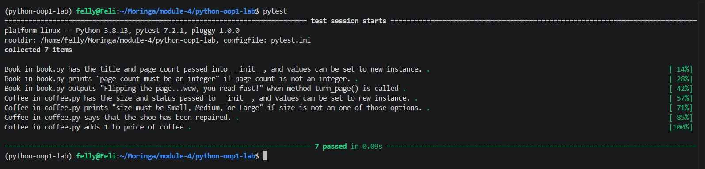

# Object Oriented Programming Lab - Bookstore 

## Description
A Python project demonstrating Object-Oriented Programming through two classes: `Book` and `Coffee`.

## Features
- Create books with a title and validated page count.
- Turn a page using the `turn_page()` method.
- Create coffee objects with a validated size and price.
- Tip for coffee using the `tip()` method, which increases the price by 1.

## Technologies
- Python
- pytest
- pipenv

## Setup
```bash
pipenv install
pipenv shell
```

## Run Tests
```bash
pytest
```

## Screenshot


## Author
Felix Ouma